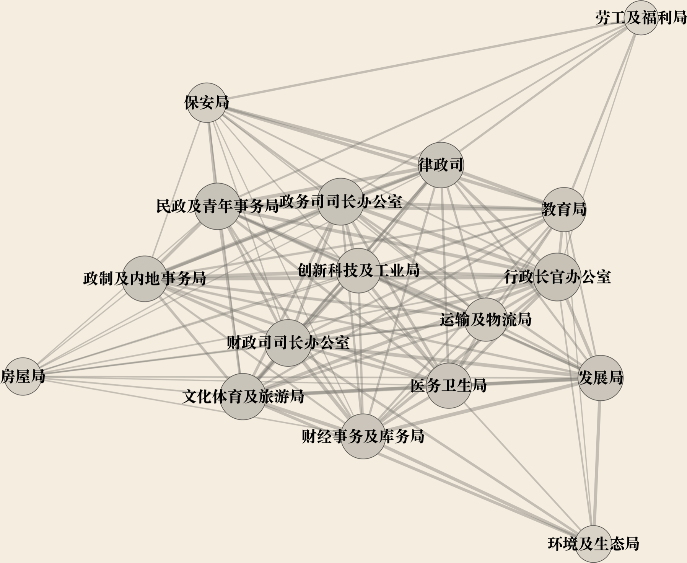

<!-- _class: lead -->

南强青年学者论坛 · 2026

<h1>孙宇飞</h1>

清华大学社会科学学院 · 政治学博士

<i>一</i>经历、研究与教学<u>约 4 分钟</u>

<i>二</i>博士论文：国家话语的同构机制研究<u>约 10 分钟</u>

<!--
各位老师好，我是孙宇飞，清华大学政治学博士。

今天的汇报分两部分：先用五分钟介绍我的经历、研究和教学，再用十分钟汇报我的博士论文。

【翻页】
-->

---

孙宇飞 · 个人学术报告

个人经历研究教学论文 · 问题论文 · 方法论文 · 发现论文 · 结论02 / 16

<h1>个人经历</h1>

<table class="t open"><tbody>
<tr><td class="k" style="width:96px">工作</td><td class="d" style="width:190px">2026.07 至今</td><td class="m" style="width:370px">美团 Keeta</td><td>大模型算法工程师2025.05–08 实习</td></tr>
<tr><td class="k">访学</td><td class="d">2024–2025</td><td class="m">东京大学社会科学研究所</td><td>客员研究员</td></tr>
<tr><td class="k">教学</td><td class="d">2021 至今</td><td class="m">清华大学 R Workshop</td><td>讲师累计选课超千人</td></tr>
<tr><td class="k">教育</td><td class="d">2020–2026</td><td class="m">清华大学</td><td>政治学 · 法学博士（大数据政治学方向）专业排名 1/89 · 优秀博士学位论文 · 优秀博士毕业生</td></tr>
<tr><td class="k"></td><td class="d">2016–2020</td><td class="m">山东大学</td><td>国际政治 · 法学学士专业排名 1/23 · 山东省优秀毕业生</td></tr>
</tbody></table>

<!--
先介绍我的经历，从下往上看。

我本科在山东大学读国际政治，专业排名第一；2020 年直博进入清华大学政治学系，方向是大数据政治学，专业排名第一，博士论文获评清华大学优秀博士学位论文。

读博期间，我从 2021 年起担任清华 R Workshop 讲师，累计选课超过一千人；2024 年到东京大学社会科学研究所做客员研究员。

2025 年我在美团实习，2026 年 7 月正式入职，担任大模型算法工程师。

【翻页】
-->

---

孙宇飞 · 个人学术报告

个人经历研究教学论文 · 问题论文 · 方法论文 · 发现论文 · 结论03 / 16

<h1>研究布局</h1>

按研究方法（列）与研究对象（行）归类

<table class="mx">
<thead><tr><th class="ax"></th><th>调查实验</th><th>观察数据 · 因果推断</th><th>文本数据 · 机器学习</th></tr></thead>
<tbody>
<tr><th class="ax">跨国 · 国外</th><td></td>
<td>
<b>“一带一路”与西巴尔干五国</b>空间双重差分 · 6 万余篇新闻情感数据《中国社会科学》拟录用 · 通讯作者

<b>美国孔子学院关闭</b>CJIP 2022 · SSCI · 通讯作者
</td>
<td class="next">
<b>研究议程</b>将文本测量方法用于跨国比较
</td></tr>
<tr><th class="ax">中国</th>
<td>
<b>公共服务动机激发</b>公共管理与政策评论 2025学生一作

<b>思想政治教育的社会化效果</b>政治与公共管理研究 2025
</td>
<td>
<b>地方治理的“能力空间”</b>广州大学学报 2023 · 第一作者

<b>助推型政策</b>公共管理与政策评论 2021 · 通讯作者
</td>
<td>
<b>领导留言板与政府回应性</b>回复文本 · 因果推断 · 在研

<b>官话识别 Bureaucratese</b>BERT 模型 · 工具已发布
</td></tr>
</tbody></table>

论文 <b>8 篇</b>

<b>《中国社会科学》</b>拟录用 1 篇

<b>SSCI</b> 1 篇

其他 <b>CSSCI</b> 4 篇

开源工具 <b>4 个</b>：Bureaucratese、SurveyAgent、Triad、regioncode

<!--
这张表是我的研究布局。横向是方法：调查实验、观察数据和因果推断、文本数据和机器学习；纵向是研究对象：中国，以及跨国和国外。

【鼠标指向上排中间】跨国研究方面，两篇代表作都在这里：一篇用空间双重差分和六万余篇新闻的情感数据，研究“一带一路”项目对西巴尔干五国媒体态度的影响，已被《中国社会科学》拟录用；另一篇研究美国孔子学院的关闭，发表在 CJIP。

【鼠标指向下排】中国研究方面，左边是两项调查实验，分别研究公共服务动机和思想政治教育的政治社会化效果；中间是地方治理和助推政策的研究；右边是文本方法，包括领导留言板的政府回应性研究，以及已经发布的官话识别工具。

【鼠标指向右上角】右上角是我接下来的方向：把文本测量方法用到跨国比较中。

【翻页】
-->

---

孙宇飞 · 个人学术报告

个人经历研究教学论文 · 问题论文 · 方法论文 · 发现论文 · 结论04 / 16

<h1>教学</h1>

可开设课程与已有基础

<table class="t">
<thead><tr><th style="width:130px">层次</th><th style="width:400px">课程</th><th>基础</th></tr></thead><tbody>
<tr><td class="k">全校通识</td><td class="m">大模型与社会科学</td><td>东京大学英文工作坊《大模型与社会科学研究》美团大模型算法工程师</td></tr>
<tr><td class="k">本科</td><td class="m">比较政治学</td><td>西巴尔干、孔子学院等跨国研究国际政治本科训练</td></tr>
<tr><td class="k"></td><td class="m">社会科学数据分析（R / Python）</td><td>清华 R Workshop 讲师2021 至今，累计选课超千人</td></tr>
<tr><td class="k">研究生</td><td class="m">计算政治学：文本分析与大模型</td><td>博士论文的 BERT 同构指数；官话识别工具R Workshop 自然语言处理课程</td></tr>
<tr><td class="k"></td><td class="m">因果推断与实验政治学</td><td>双重差分、间断时间序列两项调查实验</td></tr>
</tbody></table>

<!--
最后是教学。我可以按三个层次开课。

面向全校，我可以开一门通识课《大模型与社会科学》，这门课我在东京大学以英文工作坊的形式讲过，也和我在美团的大模型工作直接相关。

本科阶段，我可以讲比较政治学，以及 R 和 Python 的社会科学数据分析；R 语言课程我在清华已经讲了五年，累计选课超过一千人。

研究生阶段，我可以开计算政治学，重点是文本分析和大模型方法；以及因果推断与实验政治学。

这些课程和系里已有的计算社会科学、数据科学导论、社会统计等课程可以衔接起来。以上是我的个人介绍。

【翻页】
-->

---

<!-- _class: lead -->

第二部分 · 博士论文

<h1 class="long">国家话语的同构机制研究</h1>

清华大学优秀博士学位论文

A Study on the Isomorphic Mechanisms of State Discourse

<!--
下面进入第二部分，汇报我的博士论文《国家话语的同构机制研究》。

【翻页】
-->

---

孙宇飞 · 个人学术报告

个人经历研究教学论文 · 问题论文 · 方法论文 · 发现论文 · 结论06 / 16

<h1>同一份施政报告，相隔 28 年</h1>

香港特别行政区行政长官施政报告开篇

1997

香港回归祖国，<b>香港人</b>开始书写<b>自己的历史</b>……为我们自己，也为我们的后代，建设一个文明、富庶、安定、民主、充满新生命力的<b>香港</b>。

主语是香港，主轴是经济，国家战略词汇几乎缺席

2025

今年是<b>国家“十四五”规划</b>的收官之年，亦是<b>“十五五”规划</b>的谋篇布局之年……香港<b>主动对接国家发展战略</b>、实现突破新局面的策略部署。

以国家五年规划为时间轴，以对接国家战略为目标

<b>同一个位置、同一种文体，读起来像出自两套不同的政府。</b>这个变化是怎样发生的？

<!--
我想先请各位老师看两段话。

【鼠标指向左栏】左边是 1997 年，香港特区第一份施政报告的开篇：“香港人开始书写自己的历史”。主语是香港，主轴是经济，国家战略的词汇几乎看不到。

【鼠标指向右栏】右边是 2025 年的施政报告。开篇第一句就是“十四五收官、十五五谋篇”，核心任务是“主动对接国家发展战略”。

同一个位置、同一种文体，相隔二十八年，读起来却像出自两套不同的政府。

【停一拍】我的研究，就从这个变化开始。

【翻页】
-->

---

孙宇飞 · 个人学术报告

个人经历研究教学论文 · 问题论文 · 方法论文 · 发现论文 · 结论07 / 16

<h1>帽子和票子都失灵了，话语为什么还会同构？</h1>

央地整合的两条硬约束，在香港都不成立

<table class="t" style="height:auto">
<thead><tr><th style="width:230px">硬约束</th><th style="width:440px">内地</th><th>香港</th></tr></thead><tbody>
<tr style="height:104px"><td class="k">帽子 · 人事任免</td><td>晋升激励让地方迎合上级</td><td class="m">公务员体系自成一套</td></tr>
<tr style="height:104px"><td class="k">票子 · 财政调拨</td><td>转移支付把国家意志变成预算约束</td><td class="m">财政独立，不向中央缴税</td></tr>
</tbody></table>

在硬约束缺失的地方，地方治理体系为何仍在话语层面与国家深度同构？

<b>最不可能案例</b>：如果在香港都能发生，话语同构就是独立于人事和财政之外的一条整合路径。

<!--
这个变化为什么值得解释？

在内地，中央让地方跟上，主要靠两条硬约束。【鼠标指向“帽子”一行】一是“帽子”，也就是人事任免和晋升；【鼠标指向“票子”一行】二是“票子”，也就是财政和转移支付。

但在香港，这两条链条都不成立。特区公务员体系自成一套，政治锦标赛的逻辑用不上；特区财政独立，不向中央缴税。

【鼠标指向下方的问题】所以我的研究问题是：在硬约束缺失的地方，地方治理体系为什么还会在话语上与国家深度同构？

香港因此是一个“最不可能案例”：如果话语同构在这里都能发生，它就是一种独立于人事和财政之外的整合机制。

【翻页】
-->

---

孙宇飞 · 个人学术报告

个人经历研究教学论文 · 问题论文 · 方法论文 · 发现论文 · 结论08 / 16

<h1>改造经典同构理论：三个机制，三个层级</h1>

在 DiMaggio 与 Powell 的制度同构框架上做三处调整

<table class="t">
<thead><tr><th style="width:150px">经典机制</th><th style="width:200px">本研究</th><th>调整理由</th><th style="width:150px">分析层级</th></tr></thead><tbody>
<tr><td class="d">强制</td><td class="m" style="font-size:26px">规制</td><td>没有直接命令，中央改变的是规则环境；同构是行动者权衡后的选择</td><td class="k">管治团队</td></tr>
<tr><td class="d">模仿</td><td class="m" style="font-size:26px">策略性模仿</td><td>科层的模仿分化为原样“复制”与本地化“转译”两条轨道</td><td class="k">科层部门</td></tr>
<tr><td class="d">规范</td><td class="m" style="font-size:26px">互动</td><td>议员背景高度异质，规范基础不存在；转看府会问答中的话语校准</td><td class="k">立法会</td></tr>
</tbody></table>

核心立场：同构不是中央单向强加，也不是地方自发，而是各方在各自制度位置上的理性互动。

<!--
理论上，我从 DiMaggio 和 Powell 的制度同构理论出发。经典框架有三种机制：强制、模仿、规范。放到香港，需要做三处调整。

【鼠标指向第一行】第一，香港没有直接的科层命令，所以“强制”改为“规制”：中央调整的是规则环境，同构是行动者权衡之后的选择。

【鼠标指向第二行】第二，“模仿”不是均质的，它分化为原样“复制”和本地化“转译”两条轨道。

【鼠标指向第三行】第三，立法会议员背景高度异质，“规范”的基础并不存在，所以我转而观察府会之间的“互动”与校准。

这三个机制，分别对应三个层级：管治团队、科层部门和立法会。〔可删〕换句话说，同构既不是中央单向强加，也不是地方自发，而是各方在自己的制度位置上理性互动的结果。

【翻页】
-->

---

孙宇飞 · 个人学术报告

个人经历研究教学论文 · 问题论文 · 方法论文 · 发现论文 · 结论09 / 16

<h1>37 万份文本，和一个能读“逻辑”的模型</h1>

自建语料库与“形似—神似”双重测量

37.3 万

特区政府文本，1997–2025

49

政府部门，另含立法会

1,058

中央核心政治文献（参照系）

10

香港公务员深度访谈

<h3>形似 · 看词</h3>
78 个核心政治词汇，TF-IDF 相似度。 透明、可复现，但只能看到表面的同构。

<h3>神似 · 看逻辑</h3>
<b>StateDiscourseMLP</b>：基于 BERT 的分类模型。 81 万训练样本，AUC = 0.94。

输出：每份文本一个 0–1 的<b>国家话语同构指数（DA 指数）</b>，作为后续分析的因变量。

<!--
支撑这个框架的，是一套自建语料库。

【鼠标指向四个数字】它覆盖 1997 到 2025 年香港特区政府的新闻公报、部门公文和立法会质询，共 37 万份，涉及 49 个部门，是目前香港政治话语研究中规模最大、时间跨度最长的语料库。参照系是 1,058 份中央核心政治文献。此外，我还做了 10 位香港公务员的深度访谈。

【鼠标指向下方两栏】测量上，我区分“形似”和“神似”。

形似看词：用 78 个核心政治词汇计算 TF-IDF 相似度，透明、可复现，但只能看到表面的同构。

神似看逻辑：我训练了一个基于 BERT 的模型，叫 StateDiscourseMLP，训练样本 81 万，AUC 达到 0.94。〔可删〕它能识别那些没有使用国家话语原词、但叙事逻辑已经对齐的文本。

模型给每一份文本打一个 0 到 1 的分数，我称之为国家话语同构指数，下面简称 DA 指数。

【翻页】
-->

---

孙宇飞 · 个人学术报告

个人经历研究教学论文 · 问题论文 · 方法论文 · 发现论文 · 结论10 / 16

<h1>一条近三十年的曲线</h1>

DA 指数的三个阶段

1997–2006

<b>蜜月期与退场</b>回归初期高位，随后国家话语从日常公文中淡出

2007–2019

<b>缓慢爬升</b>渐进累积，增速温和

2020 年后

<b>结构性跃升</b>国安法实施、选举制度改革之后

<figure class="fig"><figcaption>国家话语同构指数（DA 指数）年度均值，1997–2025。灰色区域为 95% 置信区间。</figcaption></figure>

<!--
【鼠标指向右图】这是 DA 指数近三十年的年度均值。

回归初期有一段短暂的“蜜月期”，随后国家话语从日常公文中退场；2007 年之后缓慢爬升；2020 年国安法实施之后，进入结构性跃升。

接下来，我用三个机制来解释这条曲线。

【翻页】
-->

---

孙宇飞 · 个人学术报告

个人经历研究教学论文 · 问题论文 · 方法论文 · 发现论文 · 结论11 / 16

<h1>机制一 · 规制：从“配合”到“对接”</h1>

外部触发：规制提供宏观政治势能

动机

行政长官<b>“双重嵌入”</b>：对中央和特区双重负责，经述职、研修习得国家治理逻辑

过程

特首政策组（2022）承担“语义翻译”；538 条指定项目指标中 73 条带国家话语属性

效果

间断时间序列：国安法、选举改革两个断点均显著跃升；双重差分：高规制部门 +0.073（p &lt; 0.001）

<figure class="fig"><figcaption>事件研究：高规制部门相对低规制部门的差异，基准年 2019。</figcaption></figure>

<!--
第一个机制是规制。

信号由谁接收？关键人物是处于“双重嵌入”位置的行政长官：依《基本法》对中央和特区双重负责，同时通过述职、研修习得国家治理逻辑。2022 年成立的特首政策组承担“语义翻译”，把中央叙事转成本地公务员能执行的政策语言。

信号怎样落地？最终落到考核上：2022 到 2025 年的 538 条“指定项目指标”中，有 73 条带有国家话语属性。

是不是因果？我以国安法和选举制度改革为两个断点做间断时间序列，两次都出现显著的水平跃升；再按规制强度把部门分组做双重差分，高规制部门多出 0.073。

【鼠标指向右图】右边的事件研究图显示，2020 年之后，两组部门明显分开。

【翻页】
-->

---

孙宇飞 · 个人学术报告

个人经历研究教学论文 · 问题论文 · 方法论文 · 发现论文 · 结论12 / 16

<h1>机制二 · 模仿：“不会说、不敢说”，于是复制，也转译</h1>

科层传导：外部势能转化为组织行为

动机

<b>知识赤字</b>（“不会说”）与<b>安全赤字</b>（“不敢说”）叠加，模仿成为有限理性下的最优策略

过程

<b>复制</b>：原词照搬，2020 年前后 25.5% → 36.5% <b>转译</b>：本地化改写，稳定在 约 14%

效果

部门话语网络密度：0（2007–2015）→ 约 0.6（2020–2024）；最强连边是发展局与文体旅局（0.963）

<figure class="fig"><figcaption>特区政府 17 个决策局的话语相似度网络。</figcaption></figure>

<!--
第二个机制是模仿。

访谈中，公务员反复提到一种困境：政治上“需要说”，但他们熟悉的是普通法和新公共管理的语言，“不会说”；红线又不清楚，“不敢说”。我把它概括为知识赤字和安全赤字。在这种情况下，模仿中央的现成表述，就成了最安全的选择。

但模仿分成两条路。【鼠标指向“过程”一行】一条是“复制”，比如“爱国者治港”原词照搬，这类文本在 2020 年前后从 25.5% 升到 36.5%。另一条是“转译”，比如把“以人民为中心”改写成“以市民为本”，或者提出“盛事经济”，这类文本稳定在 14% 左右，说明科层保留了自己的能动空间。

【鼠标指向右图】结果是，部门之间的话语网络密度在 2007 到 2015 年为 0，国安法实施后的 2020 到 2024 年，年均升到 0.6 左右。相似度最高的一对部门，是发展局和文化体育及旅游局，达到 0.963。〔可删〕这两个部门职能几乎不相干，却因为北部都会区和大湾区的叙事说到了一起。

政治逻辑，压过了功能分工。

【翻页】
-->

---

孙宇飞 · 个人学术报告

个人经历研究教学论文 · 问题论文 · 方法论文 · 发现论文 · 结论13 / 16

<h1>机制三 · 互动：政治立场不再决定话语</h1>

社会再生产：府会问答中的话语校准

发现

建制派 0.759 与非建制派 0.760 无显著差异（p = 0.858）；91.8% 的差异来自同一议员的不同质询

情境

口头质询高于书面质询；工商金融界别高于专业界别；非建制派借国家话语问责（<b>批判性同构</b>）

校准

政府答复对低同构质询向上拉，对高同构质询落到执行；国家话语成为各方通用的政治资源

<figure class="fig"><figcaption>建制派与非建制派议员质询的 DA 指数年度均值，2012–2025。</figcaption></figure>

<!--
第三个机制是互动，这也是我认为最有意思的发现。

按常识，建制派和非建制派议员使用国家话语的程度应该差别很大。【鼠标指向第一行】但数据显示，两派的平均 DA 指数是 0.759 和 0.760，没有统计差异。方差分解进一步显示，91.8% 的差异发生在同一位议员的不同质询之间，而不是议员和议员之间。

【停一拍】也就是说，决定话语的不是“你是谁”，而是“你在什么场合说话”。

真正起作用的是情境：公开转播的口头质询高于书面质询；工商金融界别高于医学、建筑等专业界别；非建制派也会借用国家话语来问责政府，我称之为“批判性同构”。

〔可删〕政府的答复也在做校准：对同构程度低的质询向上拉，对同构程度高的质询则落到具体执行。

国家话语由此从立场标签，变成了各方都要使用的政治资源。

【翻页】
-->

---

孙宇飞 · 个人学术报告

个人经历研究教学论文 · 问题论文 · 方法论文 · 发现论文 · 结论14 / 16

<h1>从“行政吸纳政治”到“话语同构行政”</h1>

结论与贡献

金耀基（1975）

行政吸纳政治

行政体系消解政治

→

本研究

话语同构行政

国家政治意志经由话语重塑行政体系

<table class="t open"><tbody>
<tr><td class="k" style="width:190px">央地关系</td><td>在人事、财政之外，提出话语作为<b>“认知基础设施”</b>的整合机制</td></tr>
<tr><td class="k">制度同构理论</td><td>面向政治场域的调整：规制、策略性模仿、互动</td></tr>
<tr><td class="k">测量方法</td><td>“形似—神似”双重测量，结合时间序列、双重差分、多层模型与网络分析</td></tr>
</tbody></table>

<!--
总结一下。

【鼠标指向左边】1975 年，金耀基用“行政吸纳政治”概括港英时期的治理模式。【鼠标指向右边】我的研究发现，这个关系正在反转：中央的政治意志经由话语，反过来重塑行政体系。我把它概括为“话语同构行政”。

【鼠标指向下方三行】这项研究有三点贡献。

第一，对央地关系研究，在人事和财政之外，提出话语作为“认知基础设施”的整合机制。

第二，对制度同构理论，做了面向政治场域的调整。

第三，在方法上，提出形似与神似的双重测量，并结合时间序列、双重差分、多层模型和网络分析做三角验证。

【翻页】
-->

---

孙宇飞 · 个人学术报告

个人经历研究教学论文 · 问题论文 · 方法论文 · 发现论文 · 结论15 / 16

<h1>接下来的研究</h1>

两条主线，一个交叉方向

主线一
<h3>计算政治学</h3>
把同构指数发展为可复用的政治文本测量工具，结合大模型开源发布

基础：博士论文语料与模型、Bureaucratese

主线二
<h3>比较政治学</h3>
跨国比较中的话语扩散与国家形象

基础：西巴尔干五国、美国孔子学院研究

交叉方向
<h3>比较地方治理</h3>
用计算方法比较不同地区、不同国家的地方政府回应与治理绩效

基础：领导留言板、地方治理系列研究

研究平台：37 万份语料与同构指数模型，可用于团队研究和计算社会科学教学。

<!--
接下来，我会沿两条主线推进。

【鼠标指向左栏】第一条是计算政治学：把同构指数发展成可复用的政治文本测量工具，结合大模型开源发布。

【鼠标指向中栏】第二条是比较政治学：在西巴尔干和孔子学院研究的基础上，继续做跨国比较中的话语扩散与国家形象。

【鼠标指向右栏】两条线的交叉处，是地方治理的比较研究：用计算方法比较不同地区、不同国家的地方政府回应与治理绩效。

同时，这套语料库和模型可以作为研究平台，服务团队研究和教学。

【翻页】
-->

---

<!-- _class: lead -->

<h1 class="long">谢谢各位老师</h1>

敬请批评指正

孙宇飞 · 清华大学社会科学学院政治学系

<!--
以上是我的汇报。谢谢各位老师，请批评指正。

【微笑，停住，等待提问】
-->
