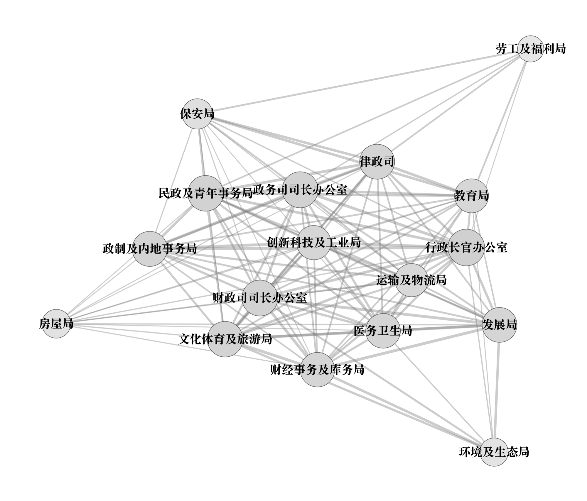
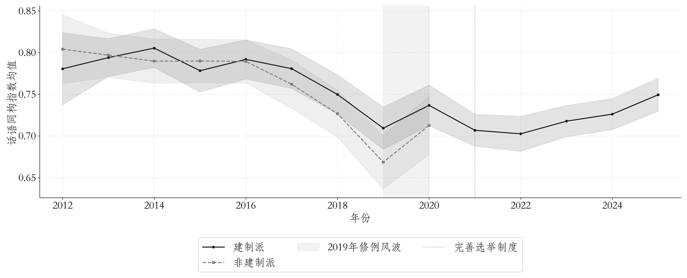

<!-- _class: lead -->
<!-- _paginate: false -->

博士学位论文汇报 · 厦门大学助理教授面试

# 国家话语的同构机制研究

<h2>A Study on the Isomorphic Mechanisms of State Discourse</h2>

清华大学优秀博士学位论文

孙宇飞 · 社会科学学院政治学系

<!--
【0:15】各位老师好，我是孙宇飞，清华大学政治学系博士。今天汇报我的博士论文《国家话语的同构机制研究》，这篇论文获评清华大学优秀博士学位论文。
-->

---

一个现象

# 同一份施政报告，相隔 28 年

1997

香港回归祖国，香港人开始书写自己的历史……为我们自己，也为我们的后代，建设一个文明、富庶、安定、民主、充满新生命力的香港。

主语是香港 · 主轴是经济 · 国家战略词汇几乎缺席

2025

今年是国家"十四五"规划的收官之年，亦是"十五五"规划的谋篇布局之年……香港主动对接国家发展战略、实现突破新局面的策略部署。

以国家五年规划为时间轴 · 以对接国家战略为目标

读起来像两套不同的政府写的。这是怎么发生的？

<!--
【0:50】我想先请各位看两段话。
左边是 1997 年香港特区第一份施政报告的开篇："香港人开始书写自己的历史"。主语是香港，主轴是经济，国家战略的词汇几乎看不到。
右边是 2025 年的施政报告，开篇就是"十四五收官、十五五谋篇"，核心任务是"主动对接国家发展战略"。
同一个位置、同一种文体，相隔二十八年，读起来像出自两套不同的政府。我的研究就从这个变化开始。
-->

---

研究谜题

# 帽子和票子都失灵了，话语为什么还会同构？

### 帽子 · 人事任免
内地：晋升激励让地方迎合上级
**香港：公务员体系自成一套** ✗

### 票子 · 财政调拨
内地：转移支付把国家意志变成预算约束
**香港：财政独立，不向中央缴税** ✗

↓

> 在硬约束缺失的地方，地方治理体系为何仍在**话语层面**与国家深度同构？

香港是<strong>最不可能案例</strong>：如果在这里都能发生，话语同构就是独立于人事和财政之外的一条整合路径。

<!--
【0:55】这个变化为什么值得解释？
在内地，中央让地方跟上，主要靠两条硬约束：一是"帽子"，人事任免和晋升；二是"票子"，财政和转移支付。
但在香港，这两条链条都不成立。特区公务员体系自成一套，政治锦标赛的逻辑用不上；特区财政独立，不向中央缴税。
所以我的问题是：在硬约束缺失的地方，地方治理体系为什么还会在话语上和国家深度同构？
香港因此是一个"最不可能案例"：如果话语同构在这里都能发生，它就是一种独立于人事和财政之外的整合机制。
-->

---

分析框架

# 改造经典同构理论：三个机制，三个层级

DiMaggio &amp; Powell：强制 · 模仿 · 规范 &nbsp;→&nbsp; 本研究：

### 强制 → 规制
没有直接命令，中央改变的是**规则环境**；同构是行动者权衡后的选择

管治团队

### 模仿 → 策略性模仿
科层的模仿分化为原样**复制**与本地化**转译**两条轨道

科层部门

### 规范 → 互动
议员背景高度异质，规范基础不存在；转看府会问答中的**话语校准**

立法会

核心立场：不是中央单向强加，也不是地方自发，而是各方在制度位置上的理性互动

<!--
【0:50】理论上，我从 DiMaggio 和 Powell 的制度同构理论出发。经典框架是强制、模仿、规范三种机制。放到香港，需要三处调整。
第一，没有直接的科层命令，"强制"改为"规制"：中央调整的是规则环境，同构是行动者权衡之后的选择。
第二，"模仿"不是均质的，分化为原样"复制"和本地化"转译"两条轨道。
第三，立法会议员背景高度异质，"规范"的基础不存在，我改为看府会之间的"互动"与校准。
三个机制分别对应三个层级：管治团队、科层部门和立法会。
-->

---

数据与测量

# 37 万份文本，和一个能读"逻辑"的模型

37.3万

特区政府文本 · 1997–2025

49

政府部门 + 立法会

1,058

中央核心政治文献（参照系）

10

香港公务员深度访谈

### 形似 · 看词
78 个核心政治词汇 · TF-IDF 相似度
透明、可复现，但只能看到"表面的同构"

### 神似 · 看逻辑
**StateDiscourseMLP**：基于 BERT 的分类模型
81 万训练样本 · AUC = 0.94

输出：每份文本一个 0–1 的<strong>国家话语同构指数（DA 指数）</strong>

<!--
【1:00】支撑这个框架的是一套自建语料库：1997 到 2025 年香港特区政府的新闻公报、部门公文和立法会质询，共 37 万份，覆盖 49 个部门。这是目前香港政治话语研究中规模最大、时间跨度最长的语料库。参照系是 1,058 份中央核心政治文献。另外还有 10 位香港公务员的深度访谈。
测量上我区分"形似"和"神似"。形似看词，用 78 个核心政治词汇计算 TF-IDF 相似度；神似看逻辑，我训练了一个基于 BERT 的模型 StateDiscourseMLP，训练样本 81 万，AUC 0.94。
模型给每份文本打一个 0 到 1 的国家话语同构指数，下面简称 DA 指数。
-->

---

总体趋势

# 一条近三十年的曲线

 

- **1997–2006** · 回归初期的"蜜月期"，随后从日常公文中退场
- **2007–2019** · 缓慢爬升，渐进累积
- **2020 年后** · 国安法、选举制度改革之后结构性跃升

下面用三个机制解释这条曲线

<!--
【0:35】这是 DA 指数近三十年的年度均值。
回归初期有一段短暂的"蜜月期"，国家话语随后从日常公文中退场；2007 年之后缓慢爬升；2020 年国安法实施之后，进入结构性跃升。
接下来我用三个机制来解释这条曲线。
-->

---

<!-- _class: tight -->

机制一 · 规制

# 从"配合"到"对接"：断裂式跃迁

**谁接收信号** · 行政长官"双重嵌入"：对中央和特区双重负责；特首政策组（2022）承担"语义翻译"

**怎样落地** · 2022–2025 年 538 条"指定项目指标"中，**73 条**带国家话语属性

**是否因果** ·

2 个

ITS 断点均显著跃升 国安法 · 选举改革

+0.073

DID · 高规制 vs 低规制部门 p &lt; 0.001

<!--
【1:05】第一个机制是规制。
接收信号的关键人物是处于"双重嵌入"位置的行政长官：依《基本法》对中央和特区双重负责，又通过述职、研修习得国家治理逻辑。2022 年成立的特首政策组承担"语义翻译"，把中央叙事转成本地公务员能执行的政策语言。
规制最终落到考核上：2022 到 2025 年 538 条"指定项目指标"中，有 73 条带有国家话语属性。
因果识别上，我以国安法和选举制度改革为两个断点做间断时间序列，两次都出现显著的水平跃升；再按规制强度把部门分组做双重差分，高规制部门多出 0.073。右图的事件研究显示，2020 年之后两组部门明显分开。
-->

---

<!-- _class: tight -->

机制二 · 模仿

# "不会说、不敢说"，于是复制，也转译

**动机** · 知识赤字（"不会说"）+ 安全赤字（"不敢说"）→ 模仿是有限理性下的最优策略

<strong>复制</strong> · "爱国者治港"原词照搬 25.5% → 36.5%
2020 年前后

<strong>转译</strong> · "以人民为中心" → "以市民为本" ≈ 14%
保持稳定 · 科层的能动空间

**结果** · 部门话语网络密度 **≈0 → 0.57**；相似度最高的一对是**发展局 × 文体旅局（0.963）**

政治逻辑压过了功能分工

<!--
【1:10】第二个机制是模仿。
访谈里公务员反复提到一种困境：政治上"需要说"，但他们熟悉的是普通法和新公共管理的语言，"不会说"；红线又不清楚，"不敢说"。我把它概括为知识赤字和安全赤字。在这种情况下，模仿中央的现成表述是最安全的选择。
但模仿分成两条路。一条是"复制"，比如"爱国者治港"原词照搬，这类文本在 2020 年前后从 25.5% 升到 36.5%。另一条是"转译"，比如把"以人民为中心"改成"以市民为本"、提出"盛事经济"，比例稳定在 14% 左右，说明科层保留了自己的能动空间。
结果是，部门之间的话语网络密度从 2007 到 2015 年的接近 0，升到 0.57。相似度最高的一对部门是发展局和文化体育及旅游局，达到 0.963。这两个部门职能几乎不相干，却因为北部都会区和大湾区叙事说到了一起。政治逻辑压过了功能分工。
-->

---

<!-- _class: tight -->

机制三 · 互动

# 反直觉：政治立场不再决定话语

0.759 ≈ 0.760

建制派 vs 非建制派 · p = 0.858

91.8%

差异来自同一议员的不同质询

**真正起作用的是情境**
- 公开转播的**口头质询** > 书面质询
- **工商金融**界别 > 医学、建筑等专业界别
- 非建制派借国家话语问责：**批判性同构**

**政府答复在校准** · 低同构质询向上拉，高同构质询落到执行

国家话语：从立场标签 → 各方通用的政治资源

<!--
【1:10】第三个机制是互动，这也是我认为最有意思的发现。
按常识，建制派和非建制派议员使用国家话语的程度应该差别很大。但数据显示，两派的平均 DA 指数是 0.759 和 0.760，没有统计差异。方差分解进一步显示，91.8% 的差异发生在同一位议员的不同质询之间，而不是议员和议员之间。
真正起作用的是情境：公开转播的口头质询高于书面质询；工商金融界别高于医学、建筑等专业界别；非建制派也会借用国家话语来问责政府，我称之为"批判性同构"。
政府答复也在做校准：对同构程度低的质询向上拉，对同构程度高的质询则落到具体执行。国家话语由此从立场标签变成了各方都要使用的政治资源。
-->

---

结论与贡献

# 从"行政吸纳政治"到"话语同构行政"

金耀基（1975） <strong>行政吸纳政治</strong> 行政体系消解政治

本研究 <strong>话语同构行政</strong> 国家政治意志经由话语重塑行政体系

### 央地关系
在人事、财政之外，提出话语作为**认知基础设施**的整合机制

### 制度同构理论
面向政治场域的调整：规制 · 策略性模仿 · 互动

### 测量方法
**形似—神似**双重测量 + ITS / DID / 多层模型 / 网络分析三角验证

<!--
【0:55】总结一下。金耀基在 1975 年用"行政吸纳政治"概括港英时期的治理模式。我的研究发现，这个关系正在反转：中央的政治意志经由话语，反过来重塑行政体系。我把它概括为"话语同构行政"。
这项研究有三点贡献。第一，对央地关系研究，在人事和财政之外，提出话语作为"认知基础设施"的整合机制。第二，对制度同构理论，做了面向政治场域的调整。第三，在方法上，提出形似和神似的双重测量，并结合时间序列、双重差分、多层模型和网络分析做三角验证。
-->

---

研究议程

# 接下来的研究

### 效能链接
话语同构是否带来**更有效的治理**？
同构指数 × 治理绩效

### 从精英到大众
政治认同是否随之变化？
社交媒体与民意数据

### 比较与外推
澳门等异质性治理单元
两岸关系中的话语整合

可开放的研究平台：37 万份语料 + 同构指数模型，可用于团队研究与计算社会科学教学

<!--
【0:45】接下来我会沿三条线继续推进。
第一是效能链接：话语同构有没有带来更有效的治理。
第二是从精英到大众：社会层面的政治认同是否随之变化。
第三是比较与外推：把这套测量方法用到澳门等其他异质性治理单元，以及两岸关系中的话语整合问题。
这套语料库和模型也可以作为一个研究平台，用于团队研究和计算社会科学的教学。
-->

---

<!-- _class: lead -->
<!-- _paginate: false -->

# 谢谢各位老师

清华大学优秀博士学位论文

孙宇飞 · 社会科学学院政治学系

<!--
【0:10】以上是我的汇报，谢谢各位老师，请批评指正。
-->
