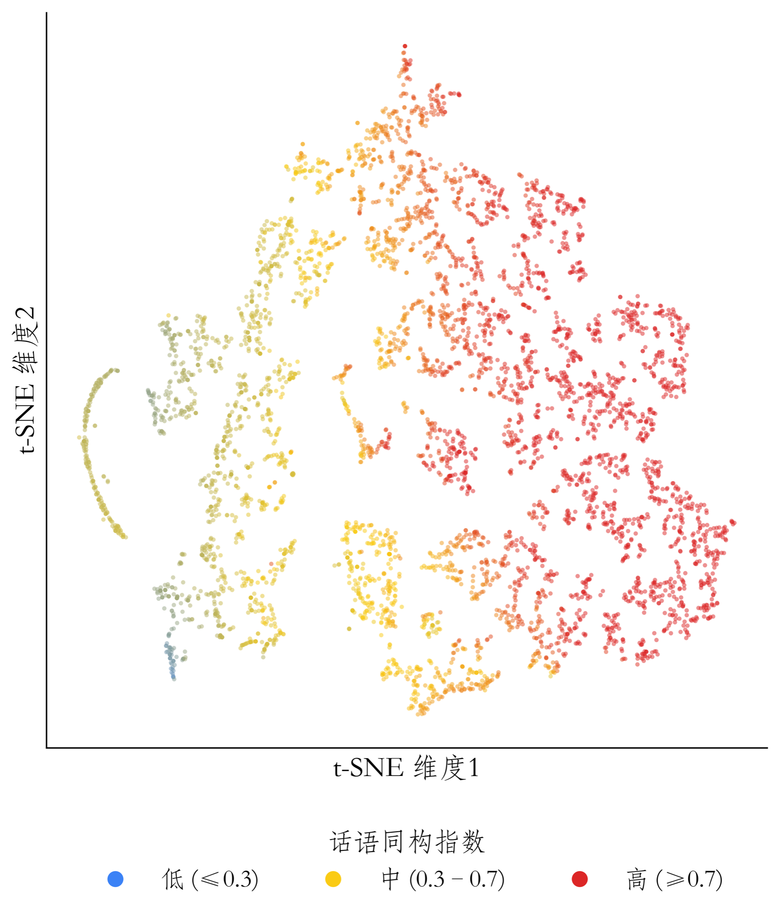
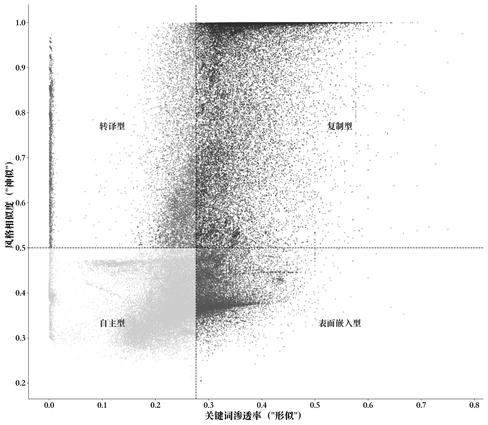

<!-- _paginate: false -->

个人陈述

孙宇飞

清华大学政治学系

厦门大学 2026 年南强青年学者论坛

<!--
各位老师好，我是孙宇飞，清华大学政治学博士。

今天的汇报分**两部分**：先用五分钟介绍我的经历、研究和教学，再用十分钟汇报我的博士论文。

【翻页】
-->

---

个人经历

2016 — 2020

山东大学 · 国际政治学士

2020 — 2026

清华大学 · 政治学博士清华大学优秀博士学位论文

2021 至今

清华大学 R Workshop · 讲师

2024 — 2025

东京大学社会科学研究所 · 客员研究员

2026 至今

美团 Keeta · 大模型算法工程师

<!--
先介绍我的经历。

我本科在**山东大学**读国际政治，2020 年直博进入**清华大学**政治学系，方向是大数据政治学，博士论文获评清华大学**优秀博士学位论文**。

读博期间，我从 2021 年起担任清华 **R Workshop** 的讲师；2024 年到东京大学社会科学研究所做客员研究员。

2025 年我在美团实习，2026 年 7 月正式入职，担任**大模型算法工程师**。所以我同时有政治学的学术训练和大模型的一线工程经验。

【翻页】
-->

---

研究领域与发表

比较政治学

“一带一路”与西巴尔干五国《中国社会科学》拟录用

美国孔子学院的关闭CJIP · SSCI

地方治理的“能力空间”《广州大学学报》

计算政治学

国家话语同构指数博士论文

官话识别模型 Bureaucratese已开源

领导留言板与政府回应性在研

已发表与拟录用论文 8 篇：《中国社会科学》1 篇 · SSCI 1 篇 · 其他 CSSCI 4 篇

<!--
我的研究集中在两个领域：**比较政治学**和**计算政治学**。

【指前三条】比较政治学方面，有两篇代表作。一篇研究“一带一路”项目对西巴尔干五国媒体态度的影响，用的是空间双重差分和六万余篇新闻的情感数据，已被**《中国社会科学》**拟录用，我是通讯作者。另一篇研究美国孔子学院的关闭，发表在 **CJIP**，是 SSCI 期刊。此外还有一篇地方治理能力的研究。

【指后三条】计算政治学方面，核心是我的博士论文：我训练了一个基于 BERT 的模型，在 37 万份政府文本上测量话语同构，稍后会详细汇报。在此基础上，我发布了官话识别模型，目前在做领导留言板与政府回应性的研究。〔可删〕我在美团的大模型工作，以及平时维护的几个开源工具，也都服务于这条线。

【指最后一行】总体上，我已发表和拟录用论文 8 篇，其中《中国社会科学》1 篇，SSCI 1 篇，其他 CSSCI 4 篇。除了这两条线，我还主导过两项调查实验。

【翻页】
-->

---

可开设课程

全校通识

大模型与社会科学

本科

比较政治学

社会科学数据分析

研究生

计算政治学

因果推断与实验政治学

<!--
教学方面，我可以开五门课，分三个层次。

【指第一条】面向全校，我可以开一门通识课**《大模型与社会科学》**。这门课我在东京大学以英文工作坊的形式讲过，也和我在美团的大模型工作直接相关。

【指本科两条】本科阶段，我可以讲**比较政治学**，以及用 R 和 Python 做社会科学数据分析；R 语言课程我在清华已经讲了五年。

【指研究生两条】研究生阶段，我可以开**计算政治学**，重点是文本分析和大模型方法；以及因果推断与实验政治学。

这些课程和系里已有的计算社会科学、数据科学导论、社会统计学等课程可以衔接起来。以上是我的个人介绍。

【翻页】
-->

---

国家话语的同构机制研究

博士学位论文

清华大学优秀博士学位论文

<!--
下面进入第二部分，汇报我的博士论文《国家话语的同构机制研究》。这篇论文获评清华大学优秀博士学位论文。

【翻页】
-->

---

研究缘起

<h3 style="color:#5C2C82;">1997 年施政报告</h3>
<blockquote style="border-left-color:#5C2C82; height:180px;">

香港回归祖国，<strong style="color:#5C2C82;">香港人</strong>开始书写<strong style="color:#5C2C82;">自己的历史</strong>……为<strong style="color:#5C2C82;">我们自己</strong>，也为<strong style="color:#5C2C82;">我们的后代</strong>，建设一个文明、富庶、安定、民主、充满新生命力的<strong style="color:#5C2C82;">香港</strong>。

</blockquote>

<h3 style="color:#EE1C25;">2025 年施政报告</h3>
<blockquote style="border-left-color:#EE1C25; height:180px;">

今年是<strong style="color:#EE1C25;">国家“十四五”规划</strong>的<strong style="color:#EE1C25;">收官之年</strong>，亦是<strong style="color:#EE1C25;">“十五五”规划</strong>的<strong style="color:#EE1C25;">谋篇布局之年</strong>。……既是香港全力<strong style="color:#EE1C25;">“拼经济谋发展惠民生”</strong>、<strong style="color:#EE1C25;">加快迈向“由治及兴”的进程表</strong>，亦是香港主动<strong style="color:#EE1C25;">对接国家发展战略</strong>、实现<strong style="color:#EE1C25;">突破新局面的策略部署</strong>。

</blockquote>

<ul style="list-style:none; padding-left:1.1em; margin:0.5em 0;">
<li style="position:relative; margin:0.3em 0; padding-left:0.2em;">•以<strong style="color:#5C2C82;">经济</strong>为核心叙事</li>
<li style="position:relative; margin:0.3em 0; padding-left:0.2em;">•强调<strong style="color:#5C2C82;">本地自主</strong>与<strong style="color:#5C2C82;">国际地位</strong></li>
<li style="position:relative; margin:0.3em 0; padding-left:0.2em;">•国家话语关键词：<strong style="color:#5C2C82;">较少出现</strong></li>
<li style="position:relative; margin:0.3em 0; padding-left:0.2em;">•话语框架：<strong style="color:#5C2C82;">行政主导</strong></li>
</ul>

<ul style="list-style:none; padding-left:1.1em; margin:0.5em 0;">
<li style="position:relative; margin:0.3em 0; padding-left:0.2em;">•以<strong style="color:#EE1C25;">政治</strong>为核心叙事</li>
<li style="position:relative; margin:0.3em 0; padding-left:0.2em;">•强调<strong style="color:#EE1C25;">顶层设计</strong>与<strong style="color:#EE1C25;">制度对接</strong></li>
<li style="position:relative; margin:0.3em 0; padding-left:0.2em;">•国家话语关键词：<strong style="color:#EE1C25;">高频出现</strong></li>
<li style="position:relative; margin:0.3em 0; padding-left:0.2em;">•话语框架：<strong style="color:#EE1C25;">政治主导</strong></li>
</ul>

<!--
我想先请各位老师看两段话。

【鼠标指向左栏】左边是 1997 年，香港特区第一份施政报告的开篇：“香港人开始书写自己的历史”。主语是香港，核心叙事是经济，国家话语的关键词很少出现。

【鼠标指向右栏】右边是 2025 年的施政报告。开篇就是“十四五收官、十五五谋篇”，核心任务是“主动对接国家发展战略”。

同一个位置、同一种文体，相隔二十八年，话语框架从**行政主导**变成了**政治主导**。

【停一拍】我的研究，就从这个变化开始。

【翻页】
-->

---

核心问题

为什么<strong style="color:#5C2C82;">香港政府</strong>的话语风格变得和<strong style="color:#EE1C25;">国家话语</strong>这么像？

↓

香港特区政府为什么用国家话语？

↙

帽子：人事晋升

↓
✗

人事高度自治

↘

票子：财政调拨

↓
✗

财政相对独立

↓

“硬约束”断裂

↓

话语/央地同构何以达成？

<!--
香港特区政府为什么会使用国家话语？这个变化为什么值得解释？

在内地，中央让地方跟上，主要靠两条硬约束。【鼠标指向左侧】一是“帽子”，也就是人事晋升；【鼠标指向右侧】二是“票子”，也就是财政调拨。

但在香港，这两条都不成立：人事高度自治，财政相对独立。

【鼠标指向下方】硬约束断裂了，话语上的同构却发生了。所以我的问题是：**在硬约束缺失的地方，话语同构何以达成？**

【翻页】
-->

---

分析框架

组织为何会变得越来越相似？

DiMaggio &amp; Powell · 制度同构理论

↙

强制性同构

↓

上级压力导致同构

↓

模仿性同构

↓

不确定性导致同构

↘

规范性同构

↓

相似背景导致同构

<!--
理论上，我从 DiMaggio 和 Powell 的制度同构理论出发。它回答的是：组织为什么会变得越来越相似？

经典答案有三种机制：强制，来自上级压力；模仿，来自不确定性；规范，来自相似的专业背景。

【翻页】
-->

---

分析框架

（香港政府）话语为何变得越来越（和国家）相似？

本研究 · 话语同构机制

↙

规制机制

↓

规制环境下的主动选择

↓

模仿机制

↓

地方能动下的策略模仿

↘

互动机制

↓

动态过程下的话语校准

<!--
放到香港，这三种机制都需要调整。

【鼠标指向左栏】第一，香港没有直接的科层命令，所以“强制”改为**规制**：中央调整的是规则环境，同构是行动者权衡之后的主动选择。

【鼠标指向中栏】第二，**模仿**不是被动的，而是地方能动之下的策略性模仿。

【鼠标指向右栏】第三，立法会议员背景高度异质，“规范”的基础并不存在，所以我转而观察府会之间的**互动**与话语校准。

三个机制分别对应三个层级：管治团队、科层部门和立法会。

【翻页】
-->

---

数据基础：同构对象

香港特区政府全样本语料库

↙

特区新闻公报

↓

职能部门公文

↘

立法会质询对

<ul class="slide8-reveal" style="list-style:none; padding-left:1.1em; margin:2em auto 0; max-width:760px;">
<li style="position:relative; margin:0.5em 0; padding-left:0.2em; font-size:20px;">•<strong style="color:var(--accent);">时间跨度最长</strong>：1997 — 2025</li>
<li style="position:relative; margin:0.5em 0; padding-left:0.2em; font-size:20px;">•<strong style="color:var(--accent);">部门覆盖最广</strong>：49 个主要政府部门、立法会</li>
<li style="position:relative; margin:0.5em 0; padding-left:0.2em; font-size:20px;">•<strong style="color:var(--accent);">文本数量最多</strong>：372,565 份语料数据</li>
</ul>

<!--
支撑这个框架的，是我自建的香港特区政府全样本语料库。

【鼠标指向三类文本】它由三部分组成：特区新闻公报、职能部门公文和立法会质询。

【鼠标指向下方三行】时间上覆盖 1997 到 2025 年，部门上覆盖 49 个主要政府部门和立法会，一共 **37 万份**文本，是目前香港政治话语研究中时间跨度最长、覆盖最广、规模最大的语料库。

参照系是 1,058 份中央核心政治文献。此外，我还访谈了 10 位香港公务员。

【翻页】
-->

---

实证策略：“形神兼备”的同构测量

“神似”：深层同构

<ul style="list-style:none; padding-left:1.2em; margin:0;">
<li style="position:relative; margin:0.3em 0; padding-left:0.2em; font-size:19px;">•意义系统的内化</li>
<li style="position:relative; margin:0.3em 0; padding-left:0.2em; font-size:19px;">•思维逻辑的同构</li>
</ul>

“神似”测量

<ul style="list-style:none; padding-left:1.2em; margin:0;">
<li style="position:relative; margin:0.3em 0; padding-left:0.2em; font-size:19px;">•基于特征融合的深度学习框架：StateDiscourseMLP</li>
<li style="position:relative; margin:0.3em 0; padding-left:0.2em; font-size:19px;">•国家话语同构指数</li>
</ul>

最终隐藏层 t-SNE 可视化

StateDiscourseMLP 模型架构

<!--
测量上，我区分“形似”和“神似”。

形似看词：用核心政治词汇计算文本相似度，透明、可复现，但只能看到表面的模仿。

【鼠标指向左栏】神似看逻辑，也就是意义系统和思维逻辑是否同构。【鼠标指向右图】为此我训练了一个基于 BERT 的深度学习模型，叫 **StateDiscourseMLP**，训练样本 81 万，AUC 达到 0.94。〔可删〕它能识别那些没有使用国家话语原词、但叙事逻辑已经对齐的文本。

模型给每一份文本打一个 0 到 1 的分数，就是**国家话语同构指数**。

【翻页】
-->

---

总体实证特征：时间演进

第一阶段

“蜜月期”与策略性退场

↓

第二阶段

“爬行整合”与“路径依赖”

↓

第三阶段

结构性断裂与范式重塑

国家话语同构指数的时间演变趋势图

<!--
【鼠标指向右图】这是同构指数近三十年的年度均值，可以分成三个阶段。

【鼠标指向左栏】第一阶段，回归初期有一段短暂的“蜜月期”，随后国家话语从日常公文中退场；第二阶段，2007 年之后缓慢爬升；第三阶段，2020 年之后出现**结构性断裂**，指数跃升到高位。

接下来，我用三个机制来解释这条曲线。

【翻页】
-->

---

一 · 规制机制

外部触发力量 为话语变迁提供宏观政治势能

同构动机

政治精英的双重嵌入

同构过程

“调节势能”而非“下达命令”

同构效果

话语同构呈断裂式跃迁，不是渐进演化

<!--
第一个机制是规制。

【鼠标指向右侧三行】动机上，关键人物是处于“双重嵌入”位置的行政长官：既对中央负责，又是特区首长。过程上，中央不是下达命令，而是调节政治势能；特首政策组把中央叙事转成本地公务员能执行的政策语言，最后落到考核指标上——2022 到 2025 年的 538 条指定项目指标中，有 73 条带有国家话语属性。

效果上，同构是**断裂式跃迁**，不是渐进演化。

【翻页】
-->

---

定量证据：结构性印记

间断时间序列分析

两个核心规制断点的<strong style="color:var(--accent);">水平跃升</strong>

+0.013***&nbsp;·&nbsp;+0.022***

国安法&nbsp;/&nbsp;选举改革

双重差分 &amp; 事件研究

高规制 vs 低规制部门<strong style="color:var(--accent);">差分估计</strong>

+0.073***

TWFE&nbsp;·&nbsp;基准 2019 年

高规制部门 vs 低规制部门

<!--
这是定量证据。

【鼠标指向左侧数字】我以国安法和选举制度改革为两个断点做间断时间序列，两次都出现显著的水平跃升。

【鼠标指向右侧数字】再按规制强度把部门分成两组做双重差分，高规制部门比低规制部门多出 **0.073**。

【鼠标指向下图】事件研究图显示，2020 年之前两组没有差别，之后明显分开。

【翻页】
-->

---

二 · 模仿机制

外部势能&nbsp;→&nbsp;科层内部的组织行为 复制与转译并行

同构动机

科层体系的“双重赤字”

同构过程

复制 vs. 转译的策略分化

同构效果

国家话语压倒传统部门功能分工，成为各局之间的“通用接口”

<!--
第二个机制是模仿，发生在科层内部。

【鼠标指向右侧第一行】访谈中，公务员反复提到一种困境：政治上“需要说”，但他们熟悉的是普通法和新公共管理的语言，**“不会说”**；红线又不清楚，**“不敢说”**。我把它概括为知识赤字和安全赤字。在这种情况下，模仿中央的现成表述，就成了最安全的选择。

【翻页】
-->

---

复制 vs 转译 · 双轨策略

复制

将<strong style="color:var(--accent);">原生概念乃至完整论述</strong>以<strong style="color:var(--accent);">高保真度移植</strong>

25.5% → 36.5%

2020 年前后比重跃升

转译

捕捉<strong style="color:var(--accent);">国家战略的底层逻辑</strong>进行<strong style="color:var(--accent);">重新包装</strong>

~ 14%

保持稳定 · 体现科层策略性能动

话语承接四象限散点分布

<!--
但模仿分成两条路。

【鼠标指向左侧】一条是**复制**，比如“爱国者治港”原词照搬，这类文本在 2020 年前后从 25.5% 升到 36.5%。

【鼠标指向右侧】另一条是**转译**，比如把“以人民为中心”改写成“以市民为本”，这类文本稳定在 14% 左右，说明科层保留了自己的能动空间。

〔可删〕结果是，部门之间的话语越来越像：国家话语压过了传统的部门分工，成为各局之间的“通用接口”。

【翻页】
-->

---

三 · 互动机制

制度化的话语博弈与校准&nbsp;·&nbsp;在立法空间使同构持续再生产

同构动机

制度情境强于政治标签

同构过程

政府答复的非线性校准

同构效应

阵营效应的话语消解

<!--
第三个机制是互动，发生在立法会。这也是我认为最有意思的发现：制度情境的作用，强于政治标签。

【翻页】
-->

---

超越阵营的话语选择

阵营均值

建制 vs 非建制<strong style="color:var(--accent);">基本重合</strong>

0.759&nbsp;≈&nbsp;0.760

双样本 t 检验&nbsp;·&nbsp;p = 0.858

变异来源

超过九成变异发生在<strong style="color:var(--accent);">同一议员的不同质询之间</strong>

91.8%

质询层方差&nbsp;·&nbsp;ICC = 0.082

按政治阵营话语同构指数均值变化趋势

↓

国家话语：<strong>意识形态标识符</strong>&nbsp;→&nbsp;<strong style="color:var(--accent);">通用的治理资源</strong>

<!--
按常识，建制派和非建制派议员使用国家话语的程度应该差别很大。

【鼠标指向左侧数字】但数据显示，两派的平均同构指数是 0.759 和 0.760，没有统计差异。

【鼠标指向右侧数字】方差分解进一步显示，**91.8%** 的差异发生在同一位议员的不同质询之间，而不是议员和议员之间。

【停一拍】也就是说，决定话语的不是“你是谁”，而是“你在什么场合说话”。

【鼠标指向底部】国家话语由此从意识形态的标识符，变成了各方通用的治理资源。

【翻页】
-->

---

异质性分析

制度情境

高曝光度的<strong style="color:var(--accent);">口头质询</strong> &gt; 书面质询 规范压力放大

利益嵌入

<strong style="color:var(--accent);">工商金融</strong>类功能界别 &gt; 医学 / 建筑等专业界别

治理资源

非建制派<strong style="color:var(--accent);">"向上问责"</strong> 建制派<strong style="color:var(--accent);">"向下负责"</strong>

↓

同一议员在不同议题与情境下采取<strong style="color:var(--accent);">差异化的话语策略</strong>——话语成为<strong style="color:var(--accent);">可调配的政治资源</strong>

<!--
真正起作用的是情境。

【依次指向三栏】公开转播的口头质询高于书面质询；工商金融界别高于医学、建筑等专业界别；非建制派也会借用国家话语来向上问责。

同一位议员，在不同议题和情境下采取不同的话语策略。话语成了可以调配的政治资源。

【翻页】
-->

---

研究总结

国家话语同构<strong style="color:var(--accent);">从外部触发、经科层传导、到社会再生产</strong>的完整链条

I · 规制

外部触发

宏观政治势能

由 <strong style="color:var(--accent);">2020 国安法 + 2021 选举改革</strong> 的双断点效应所证实

II · 模仿

科层传导

组织行为机制

由 <strong style="color:var(--accent);">复制-转译双轨</strong> 与 <strong style="color:var(--accent);">核心-边缘网络</strong> 所证实

III · 互动

社会再生产

场域博弈过程

由 <strong style="color:var(--accent);">政治阵营失效</strong> 与 <strong style="color:var(--accent);">非线性校准</strong> 所证实

<h2 style="text-align:center; font-family:var(--serif-zh); font-size:22px; font-weight:600; color:var(--accent); margin:1.6em 0 0.4em 0; letter-spacing:0.05em;">学术贡献</h2>

央地关系

解释路径补充

为央地关系研究提供<strong style="color:var(--accent);">超越物质性工具箱</strong>的补充性解释路径

制度同构

经典理论调适

对经典制度同构理论进行<strong style="color:var(--accent);">面向政治场域</strong>的系统调适与发展

测量体系

形似-神似双重

构建<strong style="color:var(--accent);">"形似-神似"</strong>话语同构双重测量体系，为大规模量化分析提供方法论探索

<!--
总结一下。

【鼠标指向上方三栏】国家话语同构是一条完整的链条：规制提供外部触发，模仿完成科层传导，互动实现社会再生产。

【鼠标指向下方三栏】这项研究有三点学术贡献。

第一，对央地关系研究，在人事和财政这些物质性工具之外，提供了一条补充性的解释路径。

第二，对制度同构理论，做了面向政治场域的调整。

第三，在方法上，构建了“形似—神似”的双重测量体系，可以用于大规模的量化分析。

【翻页】
-->

---

研究计划

计算政治学

可复用的政治文本测量工具

比较政治学

话语扩散与国家形象的跨国比较

两者交叉

地方治理与政府回应的比较研究

<!--
接下来，我会沿两条主线推进。

【指第一条】第一条是计算政治学：把同构指数发展成可复用的政治文本测量工具，结合大模型开源发布。

【指第二条】第二条是比较政治学：在西巴尔干和孔子学院研究的基础上，继续做话语扩散与国家形象的跨国比较。

【指第三条】两条线的交叉处，是地方治理的比较研究：用计算方法比较不同地区、不同国家的政府回应与治理绩效。

【翻页】
-->

---

敬请各位老师批评指正

<!--
以上是我的汇报。谢谢各位老师，请批评指正。

【停住，等待提问】
-->
