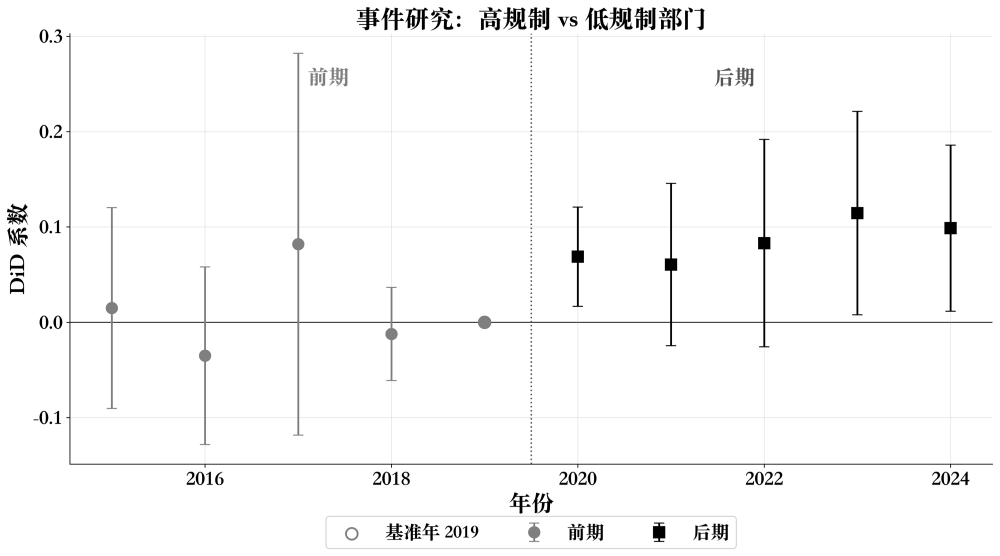

<!-- _class: lead -->
<!-- _paginate: false -->
<!-- _footer: "" -->

南强青年学者论坛 · 2026 · 个人学术报告

# 孙宇飞

<h2>清华大学社会科学学院 · 政治学博士</h2>

<!--
各位老师好，我是孙宇飞，清华大学政治学博士。

今天的汇报分两部分：先用五分钟介绍我的经历、研究和教学，再用十分钟汇报我的博士论文。

【翻页】
-->

---

# 个人经历

<table class="cv">
<tr><td class="c">工作</td><td class="d">2026.07 至今</td><td class="o">美团 Keeta</td><td class="r">大模型算法工程师（2025.05–08 实习）</td></tr>
<tr class="grp"><td class="c">访学</td><td class="d">2024–2025</td><td class="o">东京大学社会科学研究所</td><td class="r">客员研究员</td></tr>
<tr class="grp"><td class="c">教学</td><td class="d">2021 至今</td><td class="o">清华大学 R Workshop</td><td class="r">讲师 · 累计选课超千人</td></tr>
<tr class="grp"><td class="c">教育</td><td class="d">2020–2026</td><td class="o">清华大学</td><td class="r">政治学 · 法学博士（大数据政治学方向） 专业排名 1/89 · 优秀博士学位论文 · 优秀博士毕业生</td></tr>
<tr><td class="c"></td><td class="d">2016–2020</td><td class="o">山东大学</td><td class="r">国际政治 · 法学学士 专业排名 1/23 · 山东省优秀毕业生</td></tr>
</table>

<!--
先介绍我的经历，从下往上看。

我本科在山东大学读国际政治，专业排名第一；2020 年直博进入清华大学政治学系，方向是大数据政治学，专业排名第一，博士论文获评清华大学优秀博士学位论文。

读博期间，我从 2021 年起担任清华 R Workshop 讲师，累计选课超过一千人；2024 年到东京大学社会科学研究所做客员研究员。

2025 年我在美团实习，2026 年 7 月正式入职，担任大模型算法工程师。

【翻页】
-->

---

# 研究布局

<table class="matrix">
<thead><tr><th class="ax"></th><th>调查实验</th><th>观察数据 · 因果推断</th><th>文本数据 · 机器学习</th></tr></thead>
<tbody>
<tr><th class="ax">跨国 · 国外</th>
<td class="empty"></td>
<td>
<b>“一带一路”与西巴尔干五国</b>空间双重差分 · 6 万余篇新闻情感数据<em>《中国社会科学》拟录用 · 通讯作者</em>

<b>美国孔子学院关闭</b><em>Chinese Journal of International Politics 2022 · SSCI · 通讯作者</em>
</td>
<td class="next">
<b>研究议程</b>将文本测量方法用于跨国比较
</td></tr>
<tr><th class="ax">中国</th>
<td>
<b>公共服务动机激发</b><em>公共管理与政策评论 2025 · 学生一作</em>

<b>思想政治教育的政治社会化效果</b><em>政治与公共管理研究 2025</em>
</td>
<td>
<b>地方治理的“能力空间”</b><em>广州大学学报 2023 · 第一作者</em>

<b>助推型政策</b><em>公共管理与政策评论 2021 · 通讯作者</em>
</td>
<td>
<b>领导留言板与政府回应性</b>回复文本 · 因果推断 · 在研

<b>官话识别（Bureaucratese）</b>BERT 模型 · 工具已发布
</td></tr>
</tbody>
</table>

共发表论文 8 篇：《中国社会科学》拟录用 1 篇，SSCI 1 篇，其他 CSSCI 4 篇。开源工具：Bureaucratese、SurveyAgent、Triad、regioncode（CRAN）。

<!--
这张表是我的研究布局。横向是方法：调查实验、观察数据和因果推断、文本数据和机器学习；纵向是研究对象：中国，以及跨国和国外。

【鼠标指向上排中间】跨国研究方面，两篇代表作都在这里：一篇用空间双重差分和六万余篇新闻的情感数据，研究“一带一路”项目对西巴尔干五国媒体态度的影响，已被《中国社会科学》拟录用；另一篇研究美国孔子学院的关闭，发表在 CJIP。

【鼠标指向下排】中国研究方面，左边是两项调查实验，分别研究公共服务动机和思想政治教育的政治社会化效果；中间是地方治理和助推政策的研究；右边是文本方法，包括领导留言板的政府回应性研究，以及已经发布的官话识别工具。

【鼠标指向右上角】右上角是我接下来的方向：把文本测量方法用到跨国比较中。

【翻页】
-->

---

# 教学

<table class="tt">
<thead><tr><th>层次</th><th>课程</th><th>基础</th></tr></thead>
<tbody>
<tr><td class="lv">全校通识</td><td class="cn">大模型与社会科学</td><td>东京大学英文工作坊《大模型与社会科学研究》；美团大模型算法工程师</td></tr>
<tr><td class="lv">本科</td><td class="cn">比较政治学</td><td>西巴尔干、孔子学院等跨国研究；国际政治本科训练</td></tr>
<tr><td class="lv"></td><td class="cn">社会科学数据分析（R / Python）</td><td>清华 R Workshop 讲师，2021 至今，累计选课超千人</td></tr>
<tr><td class="lv">研究生</td><td class="cn">计算政治学：文本分析与大模型</td><td>博士论文的 BERT 同构指数；官话识别工具；R Workshop 自然语言处理课程</td></tr>
<tr><td class="lv"></td><td class="cn">因果推断与实验政治学</td><td>双重差分、间断时间序列；两项调查实验</td></tr>
</tbody>
</table>

<!--
最后是教学。我可以按三个层次开课。

面向全校，我可以开一门通识课《大模型与社会科学》，这门课我在东京大学以英文工作坊的形式讲过，也和我在美团的大模型工作直接相关。

本科阶段，我可以讲比较政治学，以及 R 和 Python 的社会科学数据分析；R 语言课程我在清华已经讲了五年，累计选课超过一千人。

研究生阶段，我可以开计算政治学，重点是文本分析和大模型方法；以及因果推断与实验政治学。

这些课程和系里已有的计算社会科学、数据科学导论、社会统计等课程可以衔接起来。以上是我的个人介绍。

【翻页】
-->

---

<!-- _class: lead -->
<!-- _paginate: false -->
<!-- _footer: "" -->

第二部分 · 博士论文

# 国家话语的同构机制研究

<h2>A Study on the Isomorphic Mechanisms of State Discourse</h2>

清华大学优秀博士学位论文

<!--
下面进入第二部分，汇报我的博士论文《国家话语的同构机制研究》。

【翻页】
-->
---

一个现象

# 同一份施政报告，相隔 28 年

1997

香港回归祖国，香港人开始书写自己的历史……为我们自己，也为我们的后代，建设一个文明、富庶、安定、民主、充满新生命力的香港。

主语是香港 · 主轴是经济 · 国家战略词汇几乎缺席

2025

今年是国家"十四五"规划的收官之年，亦是"十五五"规划的谋篇布局之年……香港主动对接国家发展战略、实现突破新局面的策略部署。

以国家五年规划为时间轴 · 以对接国家战略为目标

读起来像两套不同的政府写的。这是怎么发生的？

<!--
我想先请各位老师看两段话。

【鼠标指向左栏】左边是 1997 年，香港特区第一份施政报告的开篇：“香港人开始书写自己的历史”。主语是香港，主轴是经济，国家战略的词汇几乎看不到。

【鼠标指向右栏】右边是 2025 年的施政报告。开篇第一句就是“十四五收官、十五五谋篇”，核心任务是“主动对接国家发展战略”。

同一个位置、同一种文体，相隔二十八年，读起来却像出自两套不同的政府。

【停一拍】我的研究，就从这个变化开始。

【翻页】
-->

---

研究谜题

# 帽子和票子都失灵了，话语为什么还会同构？

### 帽子 · 人事任免
内地：晋升激励让地方迎合上级
**香港：公务员体系自成一套** ✗

### 票子 · 财政调拨
内地：转移支付把国家意志变成预算约束
**香港：财政独立，不向中央缴税** ✗

↓

> 在硬约束缺失的地方，地方治理体系为何仍在**话语层面**与国家深度同构？

香港是<strong>最不可能案例</strong>：如果在这里都能发生，话语同构就是独立于人事和财政之外的一条整合路径。

<!--
这个变化为什么值得解释？

在内地，中央让地方跟上，主要靠两条硬约束。【鼠标指向左卡片】一是“帽子”，也就是人事任免和晋升；【鼠标指向右卡片】二是“票子”，也就是财政和转移支付。

但在香港，这两条链条都不成立。特区公务员体系自成一套，政治锦标赛的逻辑用不上；特区财政独立，不向中央缴税。

【鼠标指向中间问题框】所以我的研究问题是：在硬约束缺失的地方，地方治理体系为什么还会在话语上与国家深度同构？

香港因此是一个“最不可能案例”：如果话语同构在这里都能发生，它就是一种独立于人事和财政之外的整合机制。

【翻页】
-->

---

分析框架

# 改造经典同构理论：三个机制，三个层级

DiMaggio &amp; Powell：强制 · 模仿 · 规范 &nbsp;→&nbsp; 本研究：

### 强制 → 规制
没有直接命令，中央改变的是**规则环境**；同构是行动者权衡后的选择

管治团队

### 模仿 → 策略性模仿
科层的模仿分化为原样**复制**与本地化**转译**两条轨道

科层部门

### 规范 → 互动
议员背景高度异质，规范基础不存在；转看府会问答中的**话语校准**

立法会

核心立场：不是中央单向强加，也不是地方自发，而是各方在制度位置上的理性互动

<!--
理论上，我从 DiMaggio 和 Powell 的制度同构理论出发。经典框架有三种机制：强制、模仿、规范。放到香港，需要做三处调整。

【鼠标指向第一栏】第一，香港没有直接的科层命令，所以“强制”改为“规制”：中央调整的是规则环境，同构是行动者权衡之后的选择。

【鼠标指向第二栏】第二，“模仿”不是均质的，它分化为原样“复制”和本地化“转译”两条轨道。

【鼠标指向第三栏】第三，立法会议员背景高度异质，“规范”的基础并不存在，所以我转而观察府会之间的“互动”与校准。

这三个机制，分别对应三个层级：管治团队、科层部门和立法会。〔可删〕换句话说，同构既不是中央单向强加，也不是地方自发，而是各方在自己的制度位置上理性互动的结果。

【翻页】
-->

---

数据与测量

# 37 万份文本，和一个能读"逻辑"的模型

37.3万

特区政府文本 · 1997–2025

49

政府部门 + 立法会

1,058

中央核心政治文献（参照系）

10

香港公务员深度访谈

### 形似 · 看词
78 个核心政治词汇 · TF-IDF 相似度
透明、可复现，但只能看到"表面的同构"

### 神似 · 看逻辑
**StateDiscourseMLP**：基于 BERT 的分类模型
81 万训练样本 · AUC = 0.94

输出：每份文本一个 0–1 的<strong>国家话语同构指数（DA 指数）</strong>

<!--
支撑这个框架的，是一套自建语料库。

【鼠标指向四个数字】它覆盖 1997 到 2025 年香港特区政府的新闻公报、部门公文和立法会质询，共 37 万份，涉及 49 个部门，是目前香港政治话语研究中规模最大、时间跨度最长的语料库。参照系是 1,058 份中央核心政治文献。此外，我还做了 10 位香港公务员的深度访谈。

【鼠标指向下方两张卡片】测量上，我区分“形似”和“神似”。

形似看词：用 78 个核心政治词汇计算 TF-IDF 相似度，透明、可复现，但只能看到表面的同构。

神似看逻辑：我训练了一个基于 BERT 的模型，叫 StateDiscourseMLP，训练样本 81 万，AUC 达到 0.94。〔可删〕它能识别那些没有使用国家话语原词、但叙事逻辑已经对齐的文本。

模型给每一份文本打一个 0 到 1 的分数，我称之为国家话语同构指数，下面简称 DA 指数。

【翻页】
-->

---

总体趋势

# 一条近三十年的曲线

 

- **1997–2006** · 回归初期的"蜜月期"，随后从日常公文中退场
- **2007–2019** · 缓慢爬升，渐进累积
- **2020 年后** · 国安法、选举制度改革之后结构性跃升

下面用三个机制解释这条曲线

<!--
【鼠标指向右图】这是 DA 指数近三十年的年度均值。

回归初期有一段短暂的“蜜月期”，随后国家话语从日常公文中退场；2007 年之后缓慢爬升；2020 年国安法实施之后，进入结构性跃升。

接下来，我用三个机制来解释这条曲线。

【翻页】
-->

---

<!-- _class: tight -->

机制一 · 规制

# 从"配合"到"对接"：断裂式跃迁

**谁接收信号** · 行政长官"双重嵌入"：对中央和特区双重负责；特首政策组（2022）承担"语义翻译"

**怎样落地** · 2022–2025 年 538 条"指定项目指标"中，**73 条**带国家话语属性

**是否因果** ·

2 个

ITS 断点均显著跃升 国安法 · 选举改革

+0.073

DID · 高规制 vs 低规制部门 p &lt; 0.001

<!--
第一个机制是规制。

信号由谁接收？关键人物是处于“双重嵌入”位置的行政长官：依《基本法》对中央和特区双重负责，同时通过述职、研修习得国家治理逻辑。2022 年成立的特首政策组承担“语义翻译”，把中央叙事转成本地公务员能执行的政策语言。

信号怎样落地？最终落到考核上：2022 到 2025 年的 538 条“指定项目指标”中，有 73 条带有国家话语属性。

是不是因果？我以国安法和选举制度改革为两个断点做间断时间序列，两次都出现显著的水平跃升；再按规制强度把部门分组做双重差分，高规制部门多出 0.073。

【鼠标指向右图】右边的事件研究图显示，2020 年之后，两组部门明显分开。

【翻页】
-->

---

<!-- _class: tight -->

机制二 · 模仿

# "不会说、不敢说"，于是复制，也转译

**动机** · 知识赤字（"不会说"）+ 安全赤字（"不敢说"）→ 模仿是有限理性下的最优策略

<strong>复制</strong> · "爱国者治港"原词照搬 25.5% → 36.5%
2020 年前后

<strong>转译</strong> · "以人民为中心" → "以市民为本" ≈ 14%
保持稳定 · 科层的能动空间

**结果** · 部门话语网络密度 **0（2007–2015）→ 约 0.6（2020–2024）**；相似度最高的一对是**发展局 × 文体旅局（0.963）**

政治逻辑压过了功能分工

<!--
第二个机制是模仿。

访谈中，公务员反复提到一种困境：政治上“需要说”，但他们熟悉的是普通法和新公共管理的语言，“不会说”；红线又不清楚，“不敢说”。我把它概括为知识赤字和安全赤字。在这种情况下，模仿中央的现成表述，就成了最安全的选择。

但模仿分成两条路。【鼠标指向左卡片】一条是“复制”，比如“爱国者治港”原词照搬，这类文本在 2020 年前后从 25.5% 升到 36.5%。【鼠标指向右卡片】另一条是“转译”，比如把“以人民为中心”改写成“以市民为本”，或者提出“盛事经济”，这类文本稳定在 14% 左右，说明科层保留了自己的能动空间。

【鼠标指向右图】结果是，部门之间的话语网络密度在 2007 到 2015 年为 0，国安法实施后的 2020 到 2024 年，年均升到 0.6 左右。相似度最高的一对部门，是发展局和文化体育及旅游局，达到 0.963。〔可删〕这两个部门职能几乎不相干，却因为北部都会区和大湾区的叙事说到了一起。

政治逻辑，压过了功能分工。

【翻页】
-->

---

<!-- _class: tight -->

机制三 · 互动

# 反直觉：政治立场不再决定话语

0.759 ≈ 0.760

建制派 vs 非建制派 · p = 0.858

91.8%

差异来自同一议员的不同质询

**真正起作用的是情境**
- 公开转播的**口头质询** > 书面质询
- **工商金融**界别 > 医学、建筑等专业界别
- 非建制派借国家话语问责：**批判性同构**

**政府答复在校准** · 低同构质询向上拉，高同构质询落到执行

国家话语：从立场标签 → 各方通用的政治资源

<!--
第三个机制是互动，这也是我认为最有意思的发现。

按常识，建制派和非建制派议员使用国家话语的程度应该差别很大。【鼠标指向左侧数字】但数据显示，两派的平均 DA 指数是 0.759 和 0.760，没有统计差异。【鼠标指向右侧数字】方差分解进一步显示，91.8% 的差异发生在同一位议员的不同质询之间，而不是议员和议员之间。

【停一拍】也就是说，决定话语的不是“你是谁”，而是“你在什么场合说话”。

真正起作用的是情境：公开转播的口头质询高于书面质询；工商金融界别高于医学、建筑等专业界别；非建制派也会借用国家话语来问责政府，我称之为“批判性同构”。

〔可删〕政府的答复也在做校准：对同构程度低的质询向上拉，对同构程度高的质询则落到具体执行。

国家话语由此从立场标签，变成了各方都要使用的政治资源。

【翻页】
-->

---

结论与贡献

# 从"行政吸纳政治"到"话语同构行政"

金耀基（1975） <strong>行政吸纳政治</strong> 行政体系消解政治

本研究 <strong>话语同构行政</strong> 国家政治意志经由话语重塑行政体系

### 央地关系
在人事、财政之外，提出话语作为**认知基础设施**的整合机制

### 制度同构理论
面向政治场域的调整：规制 · 策略性模仿 · 互动

### 测量方法
**形似—神似**双重测量 + ITS / DID / 多层模型 / 网络分析三角验证

<!--
总结一下。

【鼠标指向左框】1975 年，金耀基用“行政吸纳政治”概括港英时期的治理模式。【鼠标指向右框】我的研究发现，这个关系正在反转：中央的政治意志经由话语，反过来重塑行政体系。我把它概括为“话语同构行政”。

【鼠标指向下方三栏】这项研究有三点贡献。

第一，对央地关系研究，在人事和财政之外，提出话语作为“认知基础设施”的整合机制。

第二，对制度同构理论，做了面向政治场域的调整。

第三，在方法上，提出形似与神似的双重测量，并结合时间序列、双重差分、多层模型和网络分析做三角验证。

【翻页】
-->

---

研究议程

# 接下来的研究：两条主线，一个交叉点

### 主线一 · 计算政治学
把同构指数发展为**可复用的政治文本测量工具**
大模型 × 政治话语测量，开源发布

### 主线二 · 比较政治学
**跨国比较**中的话语扩散与国家形象
在西巴尔干、孔子学院研究基础上扩展

### 交叉 · 比较地方治理
用计算方法**比较不同地区、不同国家**的地方政府回应与治理绩效

可开放的研究平台：37 万份语料 + 同构指数模型，可用于团队研究与计算社会科学教学

<!--
接下来，我会沿两条主线推进。

【鼠标指向左栏】第一条是计算政治学：把同构指数发展成可复用的政治文本测量工具，结合大模型开源发布。

【鼠标指向中栏】第二条是比较政治学：在西巴尔干和孔子学院研究的基础上，继续做跨国比较中的话语扩散与国家形象。

【鼠标指向右栏】两条线的交叉处，是地方治理的比较研究：用计算方法比较不同地区、不同国家的地方政府回应与治理绩效。

同时，这套语料库和模型可以作为研究平台，服务团队研究和教学。

【翻页】
-->
---

<!-- _class: lead -->
<!-- _paginate: false -->
<!-- _footer: "" -->

# 谢谢各位老师

孙宇飞 · 社会科学学院政治学系

<!--
以上是我的汇报。谢谢各位老师，请批评指正。

【微笑，停住，等待提问】
-->

